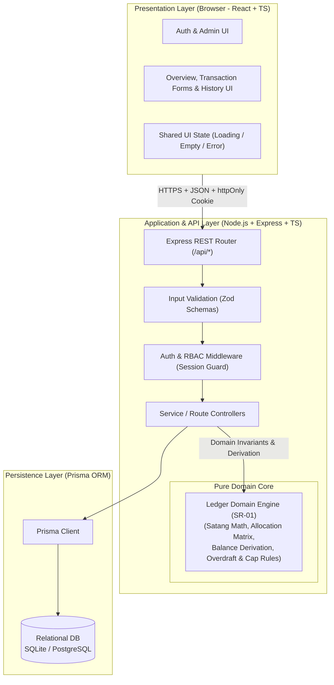
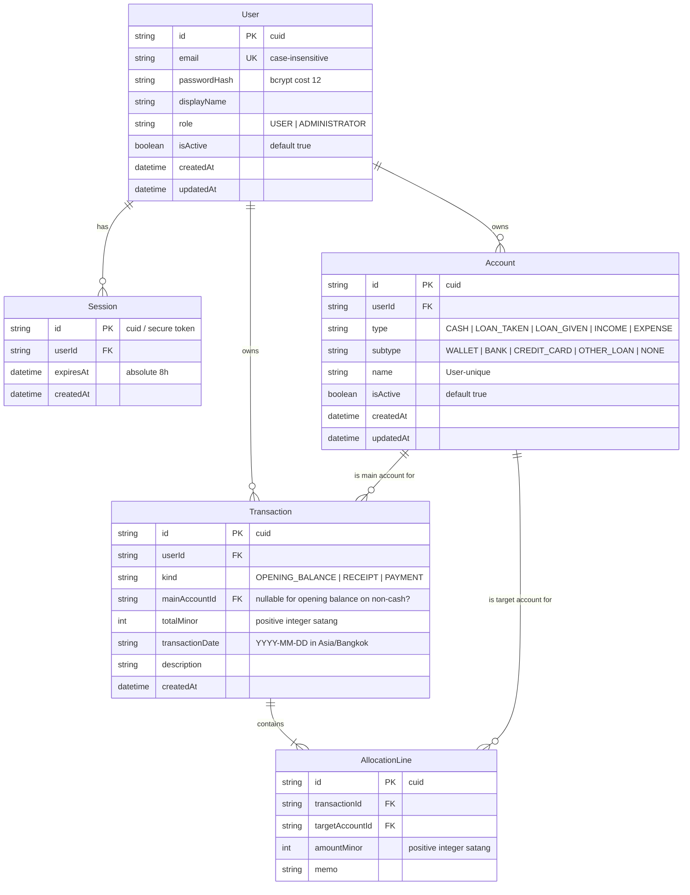

# System-Level Software Design Specification (SDS)
## Personal Money and Expense Logging System

**Course:** CPE 334 Software Engineering | Semester 1/2026  
**Document Version:** v1.0 (Sprint 1 Baseline) — 2026-10-23  
**Status:** Approved for Sprint 1 Implementation  
**Traceability:** Implements baseline requirements in `docs/srs.md` and aligns with `docs/decisions.md` (D-01 to D-25).

---

## 1. System Architecture and Technology Stack

### 1.1 Architecture Overview
The system is structured as a **Modular Monolith** containing three logical tiers:
1. **Presentation Layer (Client):** Single Page Application built with React and TypeScript, communicating over JSON HTTP with credentials (cookies).
2. **Application / API Layer (Server):** Node.js and Express with TypeScript, using layered routing, schema validation, session middleware, and an isolated **Ledger Domain Engine**.
3. **Persistence Layer (Database):** Relational database managed through Prisma ORM (SQLite for local deterministic testing and development; schema designed strictly portable for PostgreSQL deployment on Google Cloud Platform in Lab 5 per D-02).



### 1.2 Component Responsibilities and Layer Boundary Rules
To prevent business logic leakage into controllers or the UI (D-23):
- **Presentation Layer (React):** Handles view rendering, responsive layouts (360px minimum per NFR-10), client-side input masking, currency formatting (converting satang integers to decimal `฿X,XXX.XX` for display), and HTTP communication. The UI **never** determines balances or authorizes operations.
- **Routing & Validation Layer:** Parses parameters, validates schema contracts with Zod before domain logic executes, and maps domain results or exceptions to standardized HTTP responses.
- **Security Middleware:** Authenticates sessions from cryptographically signed `httpOnly` cookies, attaches the authenticated identity to request context, and enforces Role-Based Access Control (RBAC).
- **Ledger Domain Module (`src/domain/ledger`):** Pure TypeScript business logic containing **no database or HTTP dependencies**. Enforces all financial business rules:
  - Allocation line summation ([BR-01](file:///c:/Users/aricl/OneDrive/Bureau/KMUTT_classes/swe/project/group_project_ari_mathys/docs/srs.md#L143)).
  - Exact integer arithmetic in minor units (satang) ([BR-02](file:///c:/Users/aricl/OneDrive/Bureau/KMUTT_classes/swe/project/group_project_ari_mathys/docs/srs.md#L144), [NFR-04](file:///c:/Users/aricl/OneDrive/Bureau/KMUTT_classes/swe/project/group_project_ari_mathys/docs/srs.md#L172)).
  - Allowed allocation combinations by transaction kind ([BR-03](file:///c:/Users/aricl/OneDrive/Bureau/KMUTT_classes/swe/project/group_project_ari_mathys/docs/srs.md#L145), [BR-04](file:///c:/Users/aricl/OneDrive/Bureau/KMUTT_classes/swe/project/group_project_ari_mathys/docs/srs.md#L146)).
  - Balance derivation and balance-effect matrix ([BR-05](file:///c:/Users/aricl/OneDrive/Bureau/KMUTT_classes/swe/project/group_project_ari_mathys/docs/srs.md#L147), [BR-06](file:///c:/Users/aricl/OneDrive/Bureau/KMUTT_classes/swe/project/group_project_ari_mathys/docs/srs.md#L148), [D-07](file:///c:/Users/aricl/OneDrive/Bureau/KMUTT_classes/swe/project/group_project_ari_mathys/docs/decisions.md#L15), [D-09](file:///c:/Users/aricl/OneDrive/Bureau/KMUTT_classes/swe/project/group_project_ari_mathys/docs/decisions.md#L17)).
  - Cash overdraft prevention ([BR-07](file:///c:/Users/aricl/OneDrive/Bureau/KMUTT_classes/swe/project/group_project_ari_mathys/docs/srs.md#L149)).
  - Debt repayment capping ([BR-08](file:///c:/Users/aricl/OneDrive/Bureau/KMUTT_classes/swe/project/group_project_ari_mathys/docs/srs.md#L150)).
- **Persistence Layer (Prisma):** Executes database queries, enforces relational foreign-key integrity, and guarantees atomic writes using `$transaction` blocks ([NFR-03](file:///c:/Users/aricl/OneDrive/Bureau/KMUTT_classes/swe/project/group_project_ari_mathys/docs/srs.md#L171)).

---

## 2. Major Data Model and Database Design

### 2.1 Entity Relationship Diagram (ERD)



### 2.2 Entity Definitions and Field Specifications

#### `User`
- `id` (String, PK, CUID): Stable opaque identifier.
- `email` (String, Unique): Normalized lowercase email address.
- `passwordHash` (String): Stored bcrypt hash (cost factor 12). Plaintext passwords are never persisted ([NFR-02](file:///c:/Users/aricl/OneDrive/Bureau/KMUTT_classes/swe/project/group_project_ari_mathys/docs/srs.md#L170)).
- `displayName` (String): Human-friendly username.
- `role` (Enum: `USER`, `ADMINISTRATOR`): System access role ([D-05](file:///c:/Users/aricl/OneDrive/Bureau/KMUTT_classes/swe/project/group_project_ari_mathys/docs/decisions.md#L13)).
- `isActive` (Boolean, default `true`): Deactivation flag ([FR-06](file:///c:/Users/aricl/OneDrive/Bureau/KMUTT_classes/swe/project/group_project_ari_mathys/docs/srs.md#L115)).

#### `Session`
- `id` (String, PK, CUID / 256-bit secure hex string): Session identifier stored in signed cookie.
- `userId` (String, FK $\rightarrow$ `User.id`, Cascade Delete): Identifies the logged-in user.
- `expiresAt` (DateTime): Expiry timestamp set to 8 hours from creation ([D-04](file:///c:/Users/aricl/OneDrive/Bureau/KMUTT_classes/swe/project/group_project_ari_mathys/docs/decisions.md#L12), [NFR-05](file:///c:/Users/aricl/OneDrive/Bureau/KMUTT_classes/swe/project/group_project_ari_mathys/docs/srs.md#L173)).

#### `Account`
- `id` (String, PK, CUID).
- `userId` (String, FK $\rightarrow$ `User.id`, Cascade Delete): User who owns this account.
- `type` (Enum: `CASH`, `LOAN_TAKEN`, `LOAN_GIVEN`, `INCOME`, `EXPENSE`): Immutable account classification ([BR-13](file:///c:/Users/aricl/OneDrive/Bureau/KMUTT_classes/swe/project/group_project_ari_mathys/docs/srs.md#L155)).
- `subtype` (Enum: `WALLET`, `BANK`, `CREDIT_CARD`, `OTHER_LOAN`, `NONE`).
- `name` (String): Account label.
- `isActive` (Boolean, default `true`): Soft-archive flag.
- **Constraints:** Unique index on `(userId, lower(name))` enforcing case-insensitive name uniqueness per user ([BR-14](file:///c:/Users/aricl/OneDrive/Bureau/KMUTT_classes/swe/project/group_project_ari_mathys/docs/srs.md#L156)).

#### `Transaction`
- `id` (String, PK, CUID).
- `userId` (String, FK $\rightarrow$ `User.id`, Cascade Delete): Owner of the transaction.
- `kind` (Enum: `OPENING_BALANCE`, `RECEIPT`, `PAYMENT`).
- `mainAccountId` (String, FK $\rightarrow$ `Account.id`): Source account for payments, destination account for receipts, or target account for opening balance.
- `totalMinor` (Int): Total transaction sum in Thai satang ($1\text{ THB} = 100\text{ satang}$). Must be $> 0$ and $\le 1,000,000,000$ ([BR-02](file:///c:/Users/aricl/OneDrive/Bureau/KMUTT_classes/swe/project/group_project_ari_mathys/docs/srs.md#L144)).
- `transactionDate` (String / Date): Calendar date formatted `YYYY-MM-DD` in `Asia/Bangkok` timezone, $\le$ current date ([BR-09](file:///c:/Users/aricl/OneDrive/Bureau/KMUTT_classes/swe/project/group_project_ari_mathys/docs/srs.md#L151), [D-12](file:///c:/Users/aricl/OneDrive/Bureau/KMUTT_classes/swe/project/group_project_ari_mathys/docs/decisions.md#L20)).
- `description` (String, optional / empty string).
- `createdAt` (DateTime): Audit creation timestamp.

#### `AllocationLine`
- `id` (String, PK, CUID).
- `transactionId` (String, FK $\rightarrow$ `Transaction.id`, Cascade Delete): Parent transaction.
- `targetAccountId` (String, FK $\rightarrow$ `Account.id`): Target allocation account.
- `amountMinor` (Int): Allocation line amount in satang ($\ge 1$).
- `memo` (String, optional).
- **Constraints:** $\sum(\text{amountMinor}) = \text{Transaction.totalMinor}$ ([BR-01](file:///c:/Users/aricl/OneDrive/Bureau/KMUTT_classes/swe/project/group_project_ari_mathys/docs/srs.md#L143)).

### 2.3 Balance Derivation Formula
Per Decision [D-07](file:///c:/Users/aricl/OneDrive/Bureau/KMUTT_classes/swe/project/group_project_ari_mathys/docs/decisions.md#L15), running balances are not stored in a mutable column in Sprint 1 to prevent ledger drift. A user's account balance at any point in time is computed dynamically using the balance-effect matrix ([D-09](file:///c:/Users/aricl/OneDrive/Bureau/KMUTT_classes/swe/project/group_project_ari_mathys/docs/decisions.md#L17), SRS 4.3):

$$\text{Cash Balance} = \sum(\text{Opening Balance}) + \sum(\text{Receipts into Cash}) - \sum(\text{Payments from Cash})$$

$$\text{Loan Taken Debt} = \sum(\text{Opening Balance}) + \sum(\text{Charges on Loan Taken}) - \sum(\text{Repayment lines targeting Loan Taken})$$

$$\text{Loan Given Receivable} = \sum(\text{Opening Balance}) + \sum(\text{Lending lines targeting Loan Given}) - \sum(\text{Repayment lines received from Loan Given})$$

$$\text{Income Total} = \sum(\text{Receipt allocation lines targeting Income})$$

$$\text{Expense Total} = \sum(\text{Payment allocation lines targeting Expense})$$

Internal money movements (transfers between cash accounts, loan borrowings, loan repayments, and opening balances) are mathematically isolated and strictly excluded from income and expense summaries ([BR-05](file:///c:/Users/aricl/OneDrive/Bureau/KMUTT_classes/swe/project/group_project_ari_mathys/docs/srs.md#L147)).

---

## 3. UI, API, and Access Conventions

### 3.1 Role-Based Access Control (RBAC) & Ownership Matrix

| Resource / Endpoint Scope | Anonymous | `USER` | `ADMINISTRATOR` |
|---|---|---|---|
| `POST /api/auth/login` | Allowed | Allowed | Allowed |
| `POST /api/auth/logout` | 401 Unauthorized | Allowed | Allowed |
| `GET /api/auth/me` | 401 Unauthorized | Allowed | Allowed |
| `GET /api/admin/users` | 401 Unauthorized | 403 Forbidden | Allowed |
| `PATCH /api/admin/users/:id/status` | 401 Unauthorized | 403 Forbidden | Allowed (cannot disable self/last admin) |
| `GET /api/accounts` | 401 Unauthorized | Allowed (own accounts only) | 403 Forbidden |
| `POST /api/transactions/*` | 401 Unauthorized | Allowed (own accounts only) | 403 Forbidden |
| `GET /api/transactions` | 401 Unauthorized | Allowed (own records only) | 403 Forbidden |
| `GET /api/summary/*` | 401 Unauthorized | Allowed (own records only) | 403 Forbidden |
| Access to foreign user records (`:id`) | 401 Unauthorized | **404 Not Found** (D-15) | 403 Forbidden |

### 3.2 Authentication & Session Lifecycle
1. **Login (`POST /api/auth/login`):**
   - Validates email and password against stored bcrypt hash.
   - If user is inactive (`isActive === false`), returns `401 Unauthorized` with generic message `"Invalid credentials or account disabled"` (BR-21).
   - Generates a crypto-secure session identifier in the `Session` table with `expiresAt = now() + 8 hours`.
   - Sends cookie: `Set-Cookie: sid=<token>; HttpOnly; SameSite=Lax; Path=/; Max-Age=28800`.
2. **Session Verification (`requireAuth` Middleware):**
   - Reads `sid` from signed cookie.
   - Queries `Session` joined with `User`.
   - Rejects with `401` if cookie is missing, session does not exist in DB, or `expiresAt < now()`.
   - Rejects with `401` and deletes session if the user has been deactivated (`isActive === false`).
   - Injects `req.user = { id, email, role, displayName }` into request context.
3. **Logout (`POST /api/auth/logout`):**
   - Deletes session row from database immediately.
   - Clears cookie on client with `Max-Age=0`.
4. **Account Disablement by Admin:**
   - When an administrator disables a user, all session rows matching `userId` are deleted, terminating active sessions immediately ([BR-17](file:///c:/Users/aricl/OneDrive/Bureau/KMUTT_classes/swe/project/group_project_ari_mathys/docs/srs.md#L159)).

### 3.3 API Conventions & Error Envelope
All endpoints follow standard REST HTTP verbs and JSON serialization:
- **Success responses:** Return JSON with HTTP `200 OK` or `201 Created`.
- **Error responses:** Return standard error envelope with appropriate HTTP status code:
```json
{
  "error": {
    "code": "OVERDRAFT_DISALLOWED",
    "message": "Transaction rejected: Cash account balance cannot become negative.",
    "details": {
      "accountId": "cuid...",
      "currentBalanceMinor": 5000,
      "attemptedDeductionMinor": 10000
    }
  }
}
```

#### HTTP Status Codes
- `200 OK` / `201 Created`: Successful query or state creation.
- `400 Bad Request`: Schema validation error (e.g., malformed JSON, negative amount, missing required field).
- `401 Unauthorized`: Missing, expired, or invalid session cookie ([NFR-01](file:///c:/Users/aricl/OneDrive/Bureau/KMUTT_classes/swe/project/group_project_ari_mathys/docs/srs.md#L169)).
- `403 Forbidden`: Authenticated user lacks permission (e.g., user calling admin routes, or admin calling financial routes per [BR-16](file:///c:/Users/aricl/OneDrive/Bureau/KMUTT_classes/swe/project/group_project_ari_mathys/docs/srs.md#L158)).
- `404 Not Found`: Target resource does not exist **or belongs to another user** ([D-15](file:///c:/Users/aricl/OneDrive/Bureau/KMUTT_classes/swe/project/group_project_ari_mathys/docs/decisions.md#L23), [BR-10](file:///c:/Users/aricl/OneDrive/Bureau/KMUTT_classes/swe/project/group_project_ari_mathys/docs/srs.md#L152)).
- `422 Unprocessable Entity`: Syntactically valid request violates a domain business rule (e.g. allocation sum mismatch, overdraft, repayment exceeding debt).
- `500 Internal Server Error`: Unhandled failure; error handler masks internal stack traces, file paths, and database details ([NFR-08](file:///c:/Users/aricl/OneDrive/Bureau/KMUTT_classes/swe/project/group_project_ari_mathys/docs/srs.md#L176)).

### 3.4 Presentation Conventions (UI Design System)
All UI screens adhere to the following shared UX patterns ([NFR-10](file:///c:/Users/aricl/OneDrive/Bureau/KMUTT_classes/swe/project/group_project_ari_mathys/docs/srs.md#L178)):
1. **Four Fundamental States on Every View:**
   - **Loading State:** Skeleton placeholders or subtle spinner during asynchronous fetches.
   - **Empty State:** Clear informational prompt (e.g., *"No transactions recorded yet. Record your first receipt or payment above."*).
   - **Error State:** Human-readable alert banner with retry action; never raw error objects.
   - **Data State:** Interactive, high-contrast display with mobile breakpoint support down to 360px viewport width.
2. **Currency Display:** Monetary numbers are formatted with standard comma delimiters and two decimal places (`฿12,450.50`). Forms accept decimal inputs and convert to exact integer satang on submission.
3. **Allocation Form Dynamic UX:** Real-time feedback calculating the running allocation sum vs total amount, highlighting differences before submission to prevent user frustration.

---

## 4. Configuration, Environment, and Deployment Design

### 4.1 Environment Configuration ([NFR-12](file:///c:/Users/aricl/OneDrive/Bureau/KMUTT_classes/swe/project/group_project_ari_mathys/docs/srs.md#L180))
All configuration is externalized in `.env.example`:
```ini
# Server
PORT=3000
NODE_ENV=development

# Database
DATABASE_URL="file:./dev.db"

# Security & Sessions
SESSION_SECRET="change-this-to-a-secure-random-string-in-production"

# Synthetic Seed
SEED_PASSWORD="ChangeMeInLocalTesting123!"
```
*Rule:* No real credentials, production secrets, or private keys are ever committed into Git.

### 4.2 Seed and Setup Reproducibility ([NFR-06](file:///c:/Users/aricl/OneDrive/Bureau/KMUTT_classes/swe/project/group_project_ari_mathys/docs/srs.md#L174))
A fresh checkout must configure, migrate, seed, and run in 5 documented commands:
```bash
npm install
cp .env.example .env
npx prisma migrate dev --name init
npm run seed
npm test
```

### 4.3 Containerization & Cloud Deployment Architecture (Lab 5 Ready)
- The application will be packaged using a multi-stage `Dockerfile`:
  - Stage 1: Build TypeScript backend and React frontend bundle.
  - Stage 2: Minimal Node.js Alpine runtime image serving the Express API and static frontend assets.
- Data persistence is designed to survive restarts and redeployments ([NFR-07](file:///c:/Users/aricl/OneDrive/Bureau/KMUTT_classes/swe/project/group_project_ari_mathys/docs/srs.md#L175)):
  - Local / Sprint 1: SQLite database file mounted on disk or durable local volume.
  - Lab 5 (GCP): Cloud Run with Cloud SQL (PostgreSQL) or mounted persistent storage, managed via the same portable Prisma migration set.
